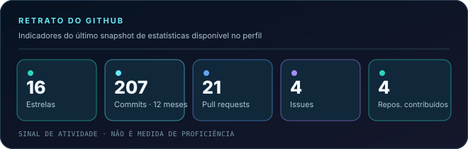
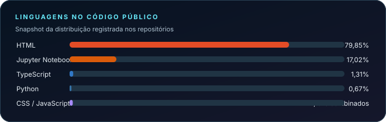

  

  
  
  

  <strong>Não estudo tecnologia em abstrato: parto de problemas reais e procuro formas melhores de compreendê-los.</strong>

---

## De onde eu venho — e por que isso importa

Sou engenheiro eletricista e trabalho com saneamento em Belém do Pará. Minha relação com tecnologia não começou numa tela: começou em sistemas que precisam funcionar no mundo real, onde operação, confiabilidade e consequências para as pessoas não são conceitos teóricos.

A formação em Engenharia Elétrica me ensinou a pensar em sistemas; Análise e Desenvolvimento de Sistemas aproximou esse raciocínio do software; DevOps, automação e infraestrutura ampliaram o olhar para o ciclo completo de uma solução. Hoje aprofundo Ciência de Dados, análise geoespacial e IA aplicada à sustentabilidade.

A pergunta que conecta essas etapas é simples: **o que conseguimos compreender quando dados que estavam separados passam a conversar?** Como transformar séries temporais, indicadores públicos, território e telemetria em evidências que ajudem alguém a decidir melhor?

É daí que vem o meu recorte: **Amazônia, água, saneamento, clima, sustentabilidade e cidades inteligentes**. Não estudo essas áreas como palavras da moda; quero experimentar como engenharia, dados e IA podem ajudar a investigar problemas reais.

<table>
  <tr>
    <td width="25%" valign="top">
      
<strong>01 · REALIDADE</strong>

      
Água, saneamento, clima, território e serviços que afetam a vida das pessoas.

    </td>
    <td width="25%" valign="top">
      
<strong>02 · DADOS</strong>

      
Fontes abertas, séries temporais, indicadores, geodados e telemetria.

    </td>
    <td width="25%" valign="top">
      
<strong>03 · INTELIGÊNCIA</strong>

      
Análise, automação, experimentos de IA e interfaces que explicam.

    </td>
    <td width="25%" valign="top">
      
<strong>04 · DECISÃO</strong>

      
Informação compreensível para investigar, priorizar e agir melhor.

    </td>
  </tr>
</table>

É esse fio condutor — **do sistema real à evidência; da evidência à decisão** — que conecta os projetos abaixo.

## Projetos com uma pergunta por trás

<table>
  <tr>
    <td width="50%" valign="top">
      
      <h3>🌿 IARA · Amazônia em dados</h3>
      
<strong>A pergunta:</strong> como tornar indicadores socioambientais mais acessíveis para quem precisa entendê-los?

      
Um painel de impacto socioambiental que aproxima indicadores climáticos e socioeconômicos, mapas regionais e análise exploratória. A camada de IA — a assistente Iara, baseada no Gemini — procura traduzir os resultados filtrados em sínteses acessíveis e recomendações contextualizadas. O desafio não é apenas exibir gráficos: é conectar variáveis, território e explicação.

      CIÊNCIA DE DADOS · PYTHON · STREAMLIT · PLOTLY
      
<a href="https://github.com/enps2015/projeto_IARA"><strong>Conhecer o projeto ↗</strong></a>

    </td>
    <td width="50%" valign="top">
      
      <h3>🐢 Guardião das Tartaruguinhas</h3>
      
<strong>A pergunta:</strong> como transformar anotações de campo em acompanhamento útil para a conservação?

      
Criado a partir da necessidade de digitalizar registros manuais de uma comunidade ribeirinha, o painel organiza o acompanhamento dos ninhos e ajuda voluntários a enxergar onde a atenção é mais necessária. A central de riscos, as fichas por ninho e a linha do tempo interativa transformam registros dispersos em uma história de monitoramento — do acompanhamento à eclosão.

      PYTHON · STREAMLIT · VISUALIZAÇÃO · CONSERVAÇÃO
      
<a href="https://github.com/enps2015/guardiao-das-tartaruguinhas"><strong>Conhecer o projeto ↗</strong></a>

    </td>
  </tr>
  <tr>
    <td width="50%" valign="top">
      
      <h3>💧 Hidrômetro Inteligente · Telemetria e dados</h3>
      
<strong>A pergunta:</strong> como testar qualidade de dados e detecção de anomalias antes de depender de uma rede física de medidores?

      
Um laboratório de dados sintéticos para estudar a engenharia que vem antes de um painel IoT: geração de telemetria com leituras a cada 15 minutos, perfis de consumo, anomalias simuladas e contexto climático/cultural. Os dados são particionados por cidade e mês, distribuídos em CSV compactado e verificados com contagens e hashes SHA-256. Isso permite experimentar pipelines e validação sem afirmar que exista uma rede física de medidores instalada.

      PYTHON · IOT · SÉRIES TEMPORAIS · ENGENHARIA DE DADOS
      
<a href="https://github.com/enps2015/smart-hydrometer-data-simulation"><strong>Conhecer o projeto ↗</strong></a>

    </td>
    <td width="50%" valign="top">
      
      <h3>🚀 Padawan Data · Portfólio e narrativa visual</h3>
      
<strong>A pergunta:</strong> como apresentar projetos técnicos de um jeito que desperte curiosidade e facilite a compreensão?

      
Um laboratório de interface, comunicação visual e apresentação de projetos. É a camada de experiência do ecossistema: tecnologia não deve apenas funcionar; precisa também ser explicada e explorável.

      HTML · CSS · JAVASCRIPT · UX/UI
      
<a href="https://enps2015.github.io/padawan-data-portfolio/"><strong>Abrir o portfólio ↗</strong></a>

    </td>
  </tr>
</table>

<a href="https://github.com/enps2015?tab=repositories"><strong>Ver todos os repositórios e experimentos →</strong></a>

---

## O mapa de estudos que conecta meus projetos

Não vejo essas áreas como caixas isoladas. Elas se cruzam no desenvolvimento de soluções:

<table>
  <tr>
    <td width="50%" valign="top">
      <h3>📊 Dados para compreender sistemas</h3>
      Ciência de Dados, análise exploratória, indicadores, séries temporais, visualização, dados geoespaciais e Engenharia de Dados.
    </td>
    <td width="50%" valign="top">
      <h3>🤖 IA aplicada</h3>
      Aprendizado de máquina, IA generativa, agentes inteligentes e experimentos orientados a problemas específicos — com atenção aos limites e à validação.
    </td>
  </tr>
  <tr>
    <td width="50%" valign="top">
      <h3>🌐 Sistemas conectados</h3>
      IoT, sistemas embarcados, Edge AI, TinyML, cidades inteligentes e Gêmeos Digitais: aproximar dados digitais do comportamento do mundo físico.
    </td>
    <td width="50%" valign="top">
      <h3>🧠 Interfaces e aprendizagem</h3>
      UX/UI, visualização cognitiva, neuroaprendizagem e design de experiências que ajudem as pessoas a entender informações complexas.
    </td>
  </tr>
</table>

  

Ícones representam ferramentas presentes no meu ecossistema de estudo e projetos; não são uma lista de certificações.

### No momento

Estou aprofundando Ciência de Dados e análise geoespacial, conectando IA aplicada à sustentabilidade e explorando sistemas inteligentes. Também participo do **Programa Embaixadores Estudantis Google Brasil 2026**, uma oportunidade de acompanhar e compartilhar novas formas de aprender e construir com tecnologia.

## Atividade no GitHub

Os cartões abaixo usam o último snapshot de estatísticas que já estava publicado no repositório; são visuais estáveis, em português, e não dependem de uma API de terceiros para aparecer. Eles indicam atividade e composição do código público — **não medem domínio técnico, experiência ou impacto**.

<table>
  <tr>
    <td width="50%" valign="top">
      
    </td>
    <td width="50%" valign="top">
      
    </td>
  </tr>
</table>

  

---

## O que espero construir daqui para frente

Quero trabalhar em projetos nos quais dados e tecnologia ajudem a **reduzir a distância entre um problema real e uma decisão melhor** — seja no saneamento, no território, na sustentabilidade, na educação ou em sistemas conectados.

Este perfil registra esse percurso: perguntas, protótipos, tentativas, validações e aprendizados. Nem tudo é produto acabado; cada repositório deve deixar claro o que está sendo explorado e o que já pode ser verificado.

  
  
  

Eric Pimentel · Belém, Pará, Brasil · Aprender, construir, validar e compartilhar.

