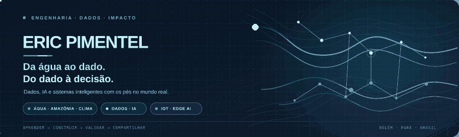
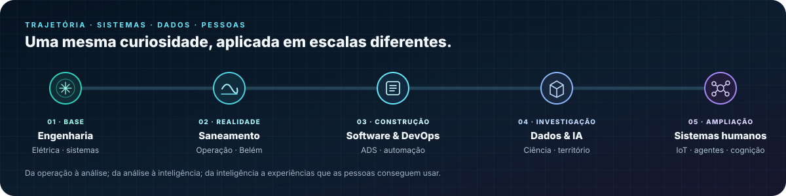
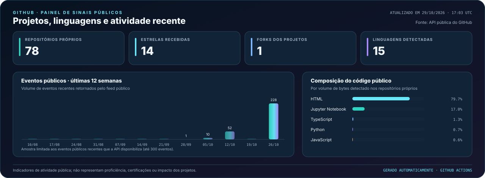

  

  
  
  

  <strong>Parto da engenharia e do saneamento para investigar problemas com dados, desenvolver soluções com IA e aproximar tecnologia das decisões do mundo real.</strong>

---

## De onde venho — e como cheguei até aqui

Sou engenheiro eletricista e trabalho com saneamento em Belém do Pará. Minha relação com tecnologia começa em sistemas que precisam funcionar de verdade: operação, confiabilidade, sinais, falhas e consequências para as pessoas. Foi essa experiência que direcionou minha curiosidade para uma pergunta: **o que os dados podem revelar sobre um sistema — e como transformar essa informação em uma decisão melhor?**

A formação em Engenharia Elétrica me ensinou a pensar em sistemas. Análise e Desenvolvimento de Sistemas aproximou esse raciocínio do software; DevOps e automação ampliaram minha visão sobre como construir, integrar e manter soluções. Hoje, aprofundo Ciência de Dados, IA aplicada, análise geoespacial e sistemas inteligentes, com atenção especial aos desafios de água, saneamento, clima, saúde e sustentabilidade na Amazônia.

Não quero acumular tecnologias como uma lista. Quero **conectar engenharia, dados e inteligência a contextos concretos** — e entender também como as pessoas aprendem, interpretam informação e interagem com os sistemas que construímos.

## Projetos: problemas reais, investigação e protótipos

<h3>🌊 IARA Data Hub — água, saneamento e saúde na Amazônia urbana</h3>

<strong>A pergunta:</strong> o que aparece quando indicadores de saneamento, internações por doenças hídricas, população e clima são analisados em conjunto?

O IARA Data Hub é um observatório de dados para a Região Metropolitana de Belém. Conecta fontes públicas como SNIS/SINISA, DATASUS/SIH, IBGE e INMET para investigar lacunas de informação, desigualdades entre municípios e relações entre saneamento, saúde e clima. O recorte estruturado reúne sete municípios e o período de 2017 a 2025, respeitando as diferenças de cobertura e atualização entre as fontes.

O objetivo não é usar um gráfico para declarar causalidade: é tornar os dados comparáveis, explicitar limitações e ajudar a formular perguntas melhores sobre a realidade local.

<strong>Foco técnico:</strong> integração de dados · análise exploratória · indicadores · visualização · geografia

<a href="https://github.com/enps2015/iara-data-hub"><strong>Explorar o projeto no GitHub ↗</strong></a>

 

<h3>💧 Hidrômetro Inteligente — da telemetria à qualidade dos dados</h3>

<strong>A pergunta:</strong> como experimentar pipelines e detecção de anomalias antes de depender de uma rede física de medidores?

Este laboratório gera telemetria hídrica sintética, com leituras em intervalos de 15 minutos, perfis de consumo e eventos anômalos simulados. Os dados podem ser particionados por cidade e mês, distribuídos em CSV compactado e verificados com contagens e hashes SHA-256. Isso permite testar preparação de séries temporais, qualidade de dados e etapas de ETL sem confundir simulação com infraestrutura implantada.

<strong>Foco técnico:</strong> Python · séries temporais · engenharia de dados · IoT · validação

<a href="https://github.com/enps2015/smart-hydrometer-data-simulation"><strong>Explorar datasets e scripts ↗</strong></a>

 

<h3>🐢 Guardião das Tartaruguinhas — dados a serviço da conservação</h3>

<strong>A pergunta:</strong> como transformar registros de campo em acompanhamento útil para quem protege ninhos de quelônios?

O projeto surgiu da necessidade de digitalizar anotações de uma comunidade ribeirinha. O painel organiza o monitoramento, destaca situações de risco e reúne fichas por ninho e uma linha do tempo interativa. A proposta é diminuir a distância entre o registro de uma observação e sua utilidade no trabalho de conservação.

<strong>Foco técnico:</strong> Python · Streamlit · visualização · storytelling de dados

<a href="https://github.com/enps2015/guardiao-das-tartaruguinhas"><strong>Explorar o projeto ↗</strong></a>

 

<h3>🧠 NeuroOrbis — aprendizagem e atlas neuroanatômico 3D</h3>

<strong>Em desenvolvimento.</strong> Um laboratório de exploração de conhecimento que reúne atlas anatômico 3D, navegação espacial, taxonomia e integrações experimentais de modelos anatômicos. Aqui, meu interesse é aproximar conteúdos complexos de uma experiência de aprendizagem explorável: como organizar a informação, orientar a navegação e deixar clara a relação entre as estruturas? É uma frente educacional e de interação, não uma ferramenta de diagnóstico clínico.

<h3>🌐 DT Academy — tornar Gêmeos Digitais e 5G mais compreensíveis</h3>

Uma iniciativa educacional que aproxima formação em Gêmeos Digitais e 5G de infográficos, design de informação e princípios de aprendizagem. O projeto nasce da experiência em construir materiais e recursos para explicar conceitos técnicos sem reduzir a complexidade do assunto.

<h3>📘 Sistemas Embarcados Inteligentes — IoT e Edge AI</h3>

<strong>Projeto editorial em desenvolvimento.</strong> O eBook conecta fundamentos de sistemas embarcados a aplicações com Arduino Uno R3 e BitDogLab v6.3 (RP2040/Pico W), explorando IoT, processamento na borda e TinyML. A intenção é construir uma ponte prática entre engenharia, sensores, dados e aplicações reais, com documentação técnica estruturada.

## Formação que amplia meu campo de atuação

### Gêmeo Digital com 5G · TIC51

O curso levou-me a explorar projetos e materiais ligados a Gêmeos Digitais, conectividade e aplicação prática. Terminei a formação em **10º lugar no ranking final dos alunos** e recebi indicação para a etapa da Residência Tecnológica em Sorocaba, no polo UniFacens. Como a residência era totalmente presencial, não consegui me inscrever. Ainda assim, fiquei muito feliz com o resultado: foi um reconhecimento concreto do trabalho desenvolvido ao longo do curso.

### InsurMinds · I2A2 — agentes inteligentes aplicados a seguros

O InsurMinds aproximou meu estudo de agentes inteligentes de um contexto de negócio específico: seguros. O que mais me interessa nesse campo é ir além de um modelo que apenas responde a uma pergunta e investigar sistemas capazes de cumprir etapas de trabalho, usar ferramentas e contexto, avaliar resultados e manter supervisão humana. Quero aprofundar arquitetura, coordenação, avaliação e confiabilidade de agentes aplicados.

### IA para Sustentabilidade · I2A2 + UFPA

Essa formação ajudou a consolidar o eixo socioambiental dos meus projetos: usar dados e IA para investigar problemas de sustentabilidade, comunicar evidências e construir experiências de análise mais acessíveis. O IARA é uma das expressões práticas desse interesse.

### Análise de Dados Geoespaciais · IBGE

A formação em análise geoespacial amplia minha capacidade de trabalhar com o contexto territorial dos indicadores — mapas, recortes regionais e relações entre localização e fenômenos socioambientais. É uma competência especialmente útil para os projetos ligados à Amazônia urbana.

### Embaixadores Estudantis Google Brasil · 2026

Também participo do Programa Embaixadores Estudantis Google Brasil 2026. Esse eixo complementa a prática técnica com experimentação e compartilhamento de usos do ecossistema Google para aprender, analisar dados e desenvolver aplicações.

### Ciência de Dados, interação humano-computador e neuroaprendizagem

Minha formação em Ciência de Dados na Gran Faculdade está ligada a uma pergunta técnica: como sair dos dados e chegar a uma explicação útil? As pós-graduações de **Ciência de Dados e Interação Humano-Computador** e **Neuroaprendizagem, Dificuldades e Transtornos** ampliam esse caminho com uma dimensão que considero essencial: as pessoas que vão interpretar e usar os sistemas.

Estudar cognição não é um adorno de interface. É uma forma de investigar como atenção, memória, carga cognitiva, aprendizagem e tomada de decisão influenciam a compreensão de informações. Quero aplicar esse olhar com rigor ao design de visualizações, interfaces de dados, ferramentas educacionais e experiências com agentes inteligentes — sem tratar conceitos de neurociência como justificativa automática para qualquer escolha de design.

## Stack tecnológica — foco em dados, IA e sistemas inteligentes

<h3>📊 Ciência de Dados &amp; Machine Learning</h3>

  
  
  
  
  
  
  

<h3>🗄️ Engenharia de Dados, Analytics &amp; Geoespacial</h3>

  
  
  
  
  
  
  
  

<h3>🤖 IA aplicada &amp; Engenharia de Agentes</h3>

  
  
  
  
  

<h3>🌐 IoT, Sistemas Embarcados, Edge AI &amp; Gêmeos Digitais</h3>

  
  
  
  
  
  
  
  

<h3>⚙️ DevOps &amp; Infraestrutura</h3>

  
  
  
  
  
  

<h3>🧠 Interação Humano-Computador, Neuroaprendizagem &amp; Design</h3>

  
  
  
  

Desenvolvimento web (HTML, CSS e JavaScript) entra como camada de interface para demonstrar e comunicar aplicações de dados; não é o eixo central da minha atuação.

## Analytics do GitHub

Os indicadores abaixo são **gerados e atualizados automaticamente por GitHub Actions**. O painel próprio consulta a API do GitHub; os cartões de estatísticas e linguagens têm rotinas diárias próprias; a animação de contribuições é regenerada em seu workflow. As imagens refletem a última execução bem-sucedida — não dados em tempo real — e não são números digitados manualmente no README.

  

  
  

  

---

## O que quero investigar a seguir

Quero aproximar Ciência de Dados, agentes inteligentes, IoT/Edge AI e cognição humana sem perder o contato com problemas reais. No saneamento e no território, isso significa trabalhar com dados confiáveis e perguntas bem formuladas. Em sistemas inteligentes e experiências de aprendizagem, significa criar interações que sejam úteis, verificáveis e compreensíveis.

Esse perfil é um registro desse percurso: projetos públicos, laboratórios em desenvolvimento, experiências de formação e perguntas que ainda estou investigando.

  
  
  

Eric Pimentel · Belém, Pará, Brasil · Engenharia → Dados → IA → Sistemas humanos.

