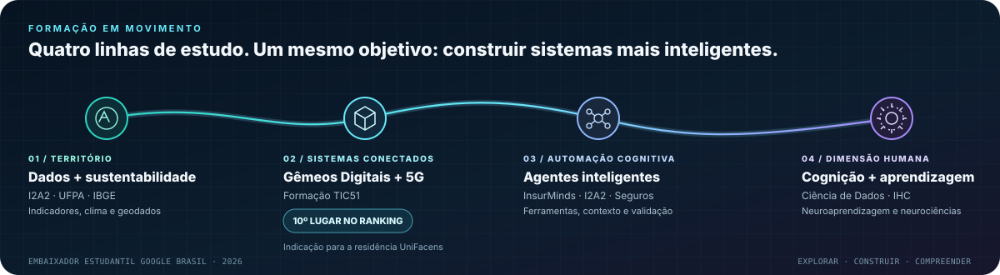
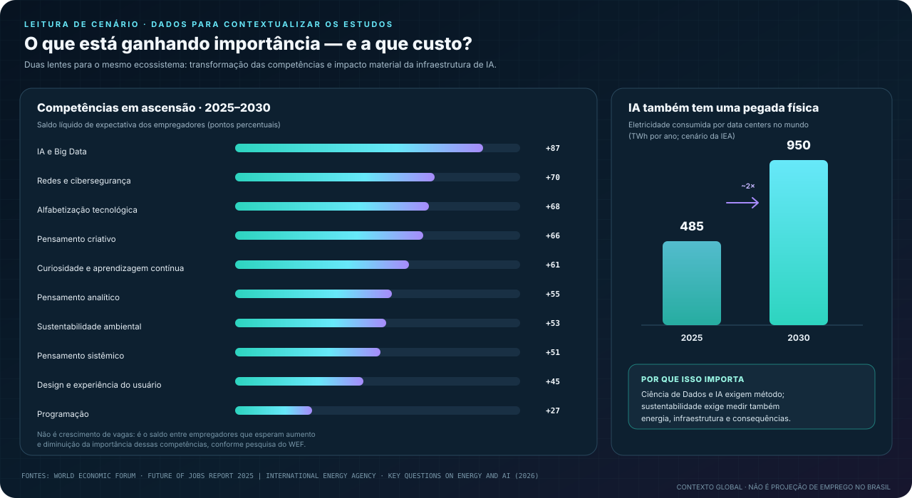

  

  
  
  

  <strong>Parto da engenharia e do saneamento para investigar problemas com dados, desenvolver soluções com IA e aproximar tecnologia das decisões do mundo real.</strong>

---

## De onde venho — e como cheguei até aqui

Sou engenheiro eletricista e trabalho com saneamento em Belém do Pará. Minha relação com tecnologia começa em sistemas que precisam funcionar de verdade: operação, confiabilidade, sinais, falhas e consequências para as pessoas. Foi essa experiência que direcionou minha curiosidade para uma pergunta: **o que os dados podem revelar sobre um sistema — e como transformar essa informação em uma decisão melhor?**

A formação em Engenharia Elétrica me ensinou a pensar em sistemas. Análise e Desenvolvimento de Sistemas aproximou esse raciocínio do software; DevOps e automação ampliaram minha visão sobre como construir, integrar e manter soluções. Hoje, aprofundo Ciência de Dados, IA aplicada, análise geoespacial e sistemas inteligentes, com atenção especial aos desafios de água, saneamento, clima, saúde e sustentabilidade na Amazônia.

Não quero acumular tecnologias como uma lista. Quero **conectar engenharia, dados e inteligência a contextos concretos** — e entender também como as pessoas aprendem, interpretam informação e interagem com os sistemas que construímos.

## Projetos: problemas reais, investigação e protótipos

<h3>🌊 IARA Data Hub — água, saneamento e saúde na Amazônia urbana</h3>

<strong>A pergunta:</strong> o que aparece quando indicadores de saneamento, internações por doenças hídricas, população e clima são analisados em conjunto?

O IARA Data Hub é um observatório de dados para a Região Metropolitana de Belém. Conecta fontes públicas como SNIS/SINISA, DATASUS/SIH, IBGE e INMET para investigar lacunas de informação, desigualdades entre municípios e relações entre saneamento, saúde e clima. O recorte estruturado reúne sete municípios e o período de 2017 a 2025, respeitando as diferenças de cobertura e atualização entre as fontes.

O objetivo não é usar um gráfico para declarar causalidade: é tornar os dados comparáveis, explicitar limitações e ajudar a formular perguntas melhores sobre a realidade local.

<strong>Foco técnico:</strong> integração de dados · análise exploratória · indicadores · visualização · geografia

<a href="https://github.com/enps2015/iara-data-hub"><strong>Explorar o projeto no GitHub ↗</strong></a>

 

<h3>💧 Hidrômetro Inteligente — da telemetria à qualidade dos dados</h3>

<strong>A pergunta:</strong> como experimentar pipelines e detecção de anomalias antes de depender de uma rede física de medidores?

Este laboratório gera telemetria hídrica sintética, com leituras em intervalos de 15 minutos, perfis de consumo e eventos anômalos simulados. Os dados podem ser particionados por cidade e mês, distribuídos em CSV compactado e verificados com contagens e hashes SHA-256. Isso permite testar preparação de séries temporais, qualidade de dados e etapas de ETL sem confundir simulação com infraestrutura implantada.

<strong>Foco técnico:</strong> Python · séries temporais · engenharia de dados · IoT · validação

<a href="https://github.com/enps2015/smart-hydrometer-data-simulation"><strong>Explorar datasets e scripts ↗</strong></a>

 

<h3>🐢 Guardião das Tartaruguinhas — dados a serviço da conservação</h3>

<strong>A pergunta:</strong> como transformar registros de campo em acompanhamento útil para quem protege ninhos de quelônios?

O projeto surgiu da necessidade de digitalizar anotações de uma comunidade ribeirinha. O painel organiza o monitoramento, destaca situações de risco e reúne fichas por ninho e uma linha do tempo interativa. A proposta é diminuir a distância entre o registro de uma observação e sua utilidade no trabalho de conservação.

<strong>Foco técnico:</strong> Python · Streamlit · visualização · storytelling de dados

<a href="https://github.com/enps2015/guardiao-das-tartaruguinhas"><strong>Explorar o projeto ↗</strong></a>

 

<h3>🧠 NeuroOrbis — aprendizagem e atlas neuroanatômico 3D</h3>

<strong>Em desenvolvimento.</strong> Um laboratório de exploração de conhecimento que reúne atlas anatômico 3D, navegação espacial, taxonomia e integrações experimentais de modelos anatômicos. Aqui, meu interesse é aproximar conteúdos complexos de uma experiência de aprendizagem explorável: como organizar a informação, orientar a navegação e deixar clara a relação entre as estruturas? É uma frente educacional e de interação, não uma ferramenta de diagnóstico clínico.

<h3>🌐 DT Academy — tornar Gêmeos Digitais e 5G mais compreensíveis</h3>

Uma iniciativa educacional que aproxima formação em Gêmeos Digitais e 5G de infográficos, design de informação e princípios de aprendizagem. O projeto nasce da experiência em construir materiais e recursos para explicar conceitos técnicos sem reduzir a complexidade do assunto.

<h3>📘 Sistemas Embarcados Inteligentes — IoT e Edge AI</h3>

<strong>Projeto editorial em desenvolvimento.</strong> O eBook conecta fundamentos de sistemas embarcados a aplicações com Arduino Uno R3 e BitDogLab v6.3 (RP2040/Pico W), explorando IoT, processamento na borda e TinyML. A intenção é construir uma ponte prática entre engenharia, sensores, dados e aplicações reais, com documentação técnica estruturada.

## Formação: conexões que se reforçam

Minha formação vem se organizando em torno de quatro eixos que se alimentam mutuamente — e não como uma sequência de cursos independentes.

**Dados e território.** A pós-graduação em Ciência de Dados na Gran Faculdade, a formação em IA para Sustentabilidade (I2A2 + UFPA) e o curso de Análise de Dados Geoespaciais do IBGE fortalecem a base analítica dos projetos que conectam saneamento, saúde, clima e desigualdades territoriais na Amazônia.

**Sistemas inteligentes no mundo físico.** No curso de Gêmeo Digital com 5G (TIC51), trabalhei com conceitos e aplicações ligados à conectividade e a sistemas digitais conectados ao mundo real. Terminei em **10º lugar no ranking final dos alunos** e fui indicado para a etapa da Residência Tecnológica em Sorocaba, no polo UniFacens. Como a residência era totalmente presencial, não consegui me inscrever; ainda assim, considero o resultado um marco importante da minha trajetória.

**Agentes que executam tarefas, não apenas respondem.** O InsurMinds, da I2A2, levou meu interesse por agentes inteligentes para o domínio de seguros. Quero aprofundar arquitetura, uso de ferramentas e contexto, coordenação de etapas, avaliação e confiabilidade — sempre considerando os limites do sistema e a supervisão humana.

**A dimensão humana da tecnologia.** As pós-graduações em Ciência de Dados e Interação Humano-Computador e em Neuroaprendizagem, Dificuldades e Transtornos ampliam a pergunta técnica: além de produzir uma resposta correta, como desenhar informação e interação para que as pessoas consigam compreender, aprender e decidir? Esse interesse orienta meu estudo de cognição, atenção, memória e carga cognitiva para visualização de dados, interfaces educacionais e experiências com sistemas inteligentes.

Essa formação técnica também se conecta à participação no **Programa Embaixadores Estudantis Google Brasil 2026**, que me permite explorar e compartilhar aplicações do ecossistema Google em aprendizagem, dados e desenvolvimento.

## Tecnologias e métodos — ferramentas com contexto

Esta seção reúne ferramentas utilizadas, estudadas ou exploradas nos projetos públicos. **A presença de um ícone, isoladamente, não significa experiência profissional avançada nem uso em produção.** Para avaliar minha experiência prática, consulte os repositórios vinculados acima: o README, o código, os testes e o estágio de desenvolvimento são as evidências relevantes.

- **Uso demonstrado em projetos:** Python, Pandas, Streamlit, Plotly, JavaScript, HTML/CSS, CSV/Parquet, testes automatizados e GitHub Actions — as combinações variam de acordo com cada projeto.
- **Em aprofundamento e experimentação:** Ciência de Dados, IA generativa e agentes, análise geoespacial, IoT/Edge AI, 5G/Gêmeos Digitais e Interação Humano-Computador.
- **Ferramentas e plataformas em estudo ou interesse:** os demais ícones e nomes abaixo não devem ser interpretados automaticamente como experiência produtiva ou domínio especializado.

A lista funciona como um mapa de interesses e aprendizagem; os repositórios constituem a evidência verificável.

### Ciência de Dados · Machine Learning

  

Pandas · NumPy · Jupyter · análise exploratória · estatística · séries temporais · visualização

### Engenharia de Dados · Analytics · Geoespacial

  

SQL · BigQuery · Databricks · Power BI · Looker Studio · Plotly · Streamlit · QGIS

### IA aplicada · LLMs · Agentes inteligentes

  

Modelos de linguagem · agentes com ferramentas · contexto · avaliação · IA para sustentabilidade

### IoT · Sistemas embarcados · Edge AI

  

BitDogLab v6.3 · RP2040 / Pico W · TinyML · Edge AI · 5G · Gêmeos Digitais

### DevOps · Infraestrutura · Ferramentas de construção

  

### Interfaces para produtos de dados

  

Interface é uma camada de entrega e comunicação dos projetos — não o eixo central do meu perfil.

## O cenário por trás das áreas que estudo

Não queria deixar a seção de analytics restrita aos números da minha conta. Este segundo gráfico conecta minhas áreas de interesse a duas fontes externas: a mudança esperada nas competências profissionais até 2030 e a demanda energética associada à expansão dos data centers para IA.

Fontes: <a href="https://reports.weforum.org/docs/WEF_Future_of_Jobs_Report_2025.pdf">World Economic Forum — Future of Jobs Report 2025</a>, figura 3.4; <a href="https://www.iea.org/reports/key-questions-on-energy-and-ai/executive-summary">International Energy Agency — Key Questions on Energy and AI</a>. No painel de competências, o valor é o saldo líquido entre empregadores que esperam aumento e diminuição da importância da competência — não é uma previsão de crescimento de vagas. Os dados de energia são uma projeção global para data centers, não uma estimativa específica do Brasil.

## Analytics do GitHub

Os indicadores abaixo são **gerados e atualizados automaticamente por GitHub Actions**. O painel próprio consulta a API do GitHub; os cartões de estatísticas e linguagens têm rotinas diárias próprias; a animação de contribuições é regenerada em seu workflow. As imagens refletem a última execução bem-sucedida — não dados em tempo real — e não são números digitados manualmente no README.

  

  
  

  

---

## O que quero investigar a seguir

Quero aproximar Ciência de Dados, agentes inteligentes, IoT/Edge AI e cognição humana sem perder o contato com problemas reais. No saneamento e no território, isso significa trabalhar com dados confiáveis e perguntas bem formuladas. Em sistemas inteligentes e experiências de aprendizagem, significa criar interações que sejam úteis, verificáveis e compreensíveis.

Esse perfil é um registro desse percurso: projetos públicos, laboratórios em desenvolvimento, experiências de formação e perguntas que ainda estou investigando.

  
  
  

Eric Pimentel · Belém, Pará, Brasil · Engenharia → Dados → IA → Sistemas humanos.

