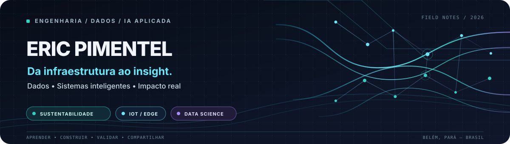

  

  
  
  

  <strong>Engenharia Elétrica → Sistemas → Dados & IA</strong> 
  Ciência de Dados · IA aplicada · Sustentabilidade · IoT & Edge

---

## 🧭 Quem sou

Sou **Engenheiro Eletricista e Analista de Sistemas**, construindo uma trajetória que conecta engenharia, análise de dados, inteligência artificial e sistemas inteligentes.

Gosto de transformar perguntas do mundo real em projetos que possam ser explorados, testados e explicados. Meu interesse especial está em **saneamento, sustentabilidade, IoT, cidades inteligentes e análise orientada por dados**.

Meu jeito de aprender é mão na massa: construir protótipos, documentar decisões, verificar a qualidade dos dados e compartilhar o conhecimento. Continuo aprofundando meus estudos em Ciência de Dados, IA aplicada, engenharia de dados e automação.

## 🧪 Projetos em destaque

<table>
  <tr>
    <td width="50%" valign="top">
      <h3>🌳 <a href="https://github.com/enps2015/projeto_IARA">IARA — Impacto Socioambiental da Amazônia</a></h3>
      
Dashboard para explorar indicadores ambientais e socioeconômicos, com visualizações geográficas, filtros dinâmicos e experimentação com geração de insights por IA.

      
Python · Streamlit · Plotly · análise de dados · IA aplicada

    </td>
    <td width="50%" valign="top">
      <h3>🐢 <a href="https://github.com/enps2015/guardiao-das-tartaruguinhas">Guardião das Tartaruguinhas</a></h3>
      
Dashboard de monitoramento comunitário de ninhos de quelônios na Amazônia, com acompanhamento de riscos, fichas de monitoramento e storytelling temporal.

      
Python · Streamlit · visualização · tecnologia socioambiental

    </td>
  </tr>
  <tr>
    <td width="50%" valign="top">
      <h3>💧 <a href="https://github.com/enps2015/smart-hydrometer-data-simulation">Smart Hydrometer Data Simulation</a></h3>
      
Telemetria hídrica sintética para experimentar engenharia de dados, séries temporais, detecção de anomalias, particionamento e validação de integridade.

      
Python · dados sintéticos · ETL · qualidade de dados · IoT

    </td>
    <td width="50%" valign="top">
      <h3>🌌 <a href="https://enps2015.github.io/padawan-data-portfolio/">Padawan Data Portfolio</a></h3>
      
Meu portfólio web, com identidade visual inspirada em ficção científica para apresentar projetos, competências e minha jornada na área de dados.

      
HTML · CSS · JavaScript · UX/UI · visualização

    </td>
  </tr>
</table>

  <a href="https://github.com/enps2015?tab=repositories"><strong>Explorar todos os repositórios →</strong></a>

## 🧰 Tecnologias e áreas de exploração

<strong>Ciência de Dados & IA</strong>

  

<strong>Engenharia, DevOps & Cloud</strong>

  

<strong>IoT, Edge & construção de interfaces</strong>

  

  Também exploro Pandas, NumPy, SQL, Streamlit, Plotly, Power BI, Looker Studio e ferramentas de automação. Os ícones identificam tecnologias do meu ecossistema de estudos e projetos — não representam, isoladamente, uma certificação ou um nível uniforme de proficiência.

## 📊 GitHub em dados

  
  

  Os cartões são gerados pelo GitHub Actions, armazenados neste repositório e atualizados diariamente. As métricas representam atividade pública; linguagens detectadas não medem, por si só, domínio técnico.

### 🐍 Contribuições ao longo do tempo

  <picture>
    <source media="(prefers-color-scheme: dark)" srcset="https://raw.githubusercontent.com/enps2015/enps2015/output/github-snake-dark.svg" />
    <source media="(prefers-color-scheme: light)" srcset="https://raw.githubusercontent.com/enps2015/enps2015/output/github-snake.svg" />
    
  </picture>

  A primeira geração é disparada quando esta configuração chega à branch <code>main</code>; depois, os SVGs são atualizados diariamente e também podem ser gerados manualmente pela aba <strong>Actions</strong>.

---

## 🤝 Vamos trocar ideias?

Estou sempre interessado em aprender com outras pessoas, compartilhar descobertas e colaborar em projetos que usem dados e tecnologia para resolver problemas reais.

  <a href="https://www.linkedin.com/in/ericpimentel-dados/">LinkedIn</a> ·
  <a href="https://enps2015.github.io/padawan-data-portfolio/">Portfólio</a> ·
  <a href="https://github.com/enps2015?tab=repositories">Repositórios</a> ·
  <a href="mailto:enps2006@yahoo.com.br">E-mail</a>

Feito com curiosidade, pensamento crítico e aprendizagem contínua. ✨

